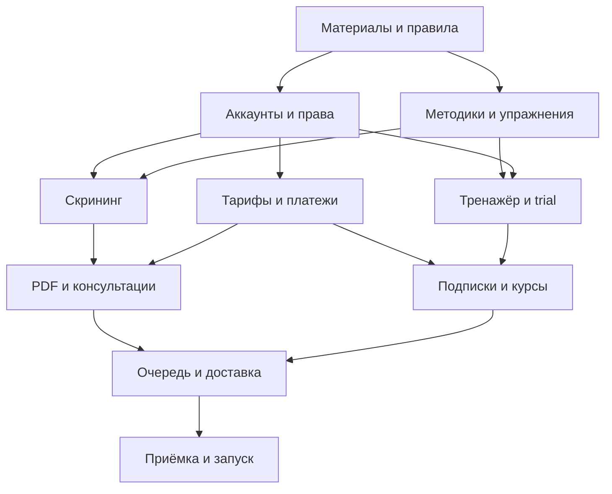

## Навигация и контроль выполнения

[Админка: все 52 группы сущностей](https://github.com/Bambale0/marina/issues/2) · [Правила TDD, develop и main](https://github.com/Bambale0/marina/issues/3) · [Решения и условия публикации](https://github.com/Bambale0/marina/issues/4)

**14 эпиков / 96 задач.** Эпики отмечаются после реализации, административного покрытия и приёмки; документация не закрывает реализацию.

- [ ] https://github.com/Bambale0/marina/issues/4
- [ ] https://github.com/Bambale0/marina/issues/5
- [ ] https://github.com/Bambale0/marina/issues/6
- [ ] https://github.com/Bambale0/marina/issues/7
- [ ] https://github.com/Bambale0/marina/issues/8
- [ ] https://github.com/Bambale0/marina/issues/9
- [ ] https://github.com/Bambale0/marina/issues/10
- [ ] https://github.com/Bambale0/marina/issues/11
- [ ] https://github.com/Bambale0/marina/issues/12
- [ ] https://github.com/Bambale0/marina/issues/13
- [ ] https://github.com/Bambale0/marina/issues/14
- [ ] https://github.com/Bambale0/marina/issues/15
- [ ] https://github.com/Bambale0/marina/issues/16
- [ ] https://github.com/Bambale0/marina/issues/17

---

# Пайплайн разработки

## Первый рабочий результат

Разработчик начинает с E00 и E01: единый аккаунт, взрослый/детский профиль, серверное ограничение доступа и административная карточка. Параллельно специалист готовит одну методику с контрольными примерами. Затем первый полный проход E02: выбор подходящей анкеты → ответы → воспроизводимый бесплатный результат → результат и исходные данные в кабинете специалиста.

Не нужно ждать готовности всех методик, видео и курсов, чтобы построить этот проход. Неготовый материал нельзя публиковать клиентам как утверждённый.

## Этапы и выходы

| Этап | Эпики | Результат, который можно показать | Условия выхода |
| --- | --- | --- | --- |
| 0. Основа и материалы | E00, E01; подготовка E03/E08 | Вход, свой профиль, кабинет администратора, реестр решений и материалов | Изоляция аккаунтов; понятен первый публикуемый методический пакет |
| 1. Бесплатная воронка | E02 | Одна утверждённая анкета и бесплатный результат | Расчёт воспроизводится по примерам; предыдущие версии сохранены |
| 2. Первая платная услуга | E03, E04, E05 | Цена → разовая оплата → черновик → проверка специалиста → доступный PDF | Согласованы тариф и платёжный маршрут; повторы не дублируют исполнение; срок 48 часов отслеживается |
| 3. Консультации | E06, E07 | Полный комплект → основной ответ → одно уточнение; заявка на встречу | Проверены таймеры 48/24/48; специалист управляет состояниями и временем |
| 4. Занятия и продажи доступа | E08, E09, E10 | Утверждённый комплекс, trial 72 часа, выбранные детские подписки и ручное продление | Готовы упражнения/видео; правила семьи и периодов однозначны; доступ связан с оплатой |
| 5. Курсы и эксплуатация | E11, E12, E13 | Отдельный курс, единая операционная панель, подготовленный выпуск | Готова программа курса; проверены восстановление и публикуемые сценарии; main требует разрешения |

E12 — объединение операционного управления. Минимальная очередь, фиксация сроков, доставка и обработка ошибок входят в каждый соответствующий ранний эпик; их нельзя откладывать до последнего этапа. E13 применяется к каждому публикуемому набору функций, а не только к финалу всей разработки.

## Что можно вести параллельно

- После определения аккаунтов E02 и E03 развиваются независимо, если готов пакет первой методики.
- Подготовка упражнений, съёмка видео и программы курсов идут параллельно серверной основе.
- После общего заказа E05 и E06 могут развиваться отдельными рабочими ветками.
- E08/E09 могут проверяться на готовых материалах до запуска платного E10.
- Веб-объём, платёжные условия и методические решения решаются с владельцем по [реестру](https://github.com/Bambale0/marina/issues/4), без остановки независимых задач.

## Формат одной задачи

Из эпика выбирается небольшой результат с идентификатором `E##-##`. Перед кодом записывается пример приёмки. RED воспроизводит нужное поведение; GREEN даёт минимальный полный проход; рефакторинг выполняется при зелёных проверках. Клиентский и административный интерфейсы доводятся вместе. Внешние платежи и ИИ подменяются на границе, реальные ограничения БД проверяются интеграционно.

Затем PR рабочей ветки в `develop`, демонстрация и применимые проверки. Эпик закрывается после реализации его критериев, не после загрузки этого плана.

## Оценка

96 задач — исходная декомпозиция, а не 96 одинаковых по трудоёмкости работ. Разработчик оценивает задачи после инвентаризации материалов и определения веб-объёма. В оценке отдельно выделяются интерфейсы, сервер, интеграции, подготовка контента и проверка специалистом. Размер команды, календарные сроки и бюджет пока не утверждены.

## Выпуск

В `develop` собирается проверяемая версия. Для `main` готовится отдельный конкретный результат с описанием поведения, состояния проверок и ограничений; только затем запрашивается явное разрешение владельца. Полный порядок — [CONTRIBUTING.md](https://github.com/Bambale0/marina/issues/3).

---

# «Нейроразвитие дома»: план разработки после интервью

**Версия:** 1.1  
**Дата:** 20 октября 2026 года  
**Назначение:** передача разработчику для декомпозиции, оценки и реализации через TDD.  
**Статус:** спецификация будущего продукта. Описанные проверки — критерии будущей реализации, а не отчёт об уже выполненных тестах.

**Репозиторий:** https://github.com/Bambale0/marina  
**Навигация:** [индекс плана](https://github.com/Bambale0/marina/issues/1), [подробные эпики](https://github.com/Bambale0/marina/issues/1), [матрица админки](https://github.com/Bambale0/marina/issues/2), [порядок работы](https://github.com/Bambale0/marina/issues/3).

## Обязательные правила проекта

1. Управление всеми сущностями и бизнес-настройками продукта выполняется через админку. Каждая сущность получает карточку, допустимые операции и историю; подробное покрытие — в [матрице](https://github.com/Bambale0/marina/issues/2). Для финансовых фактов и опубликованных результатов управление означает проверяемые операции и версии, а не переписывание истории.
2. Рабочие изменения проходят через feature/docs-ветку в `develop`. Публикация документов не означает реализацию эпиков.
3. Создание, изменение и слияние в `main` выполняются только после отдельного явного разрешения владельца на конкретный подготовленный результат. Автоматическое слияние в `main` не включается.

## Как читать документ

**Согласовано** — прямые ответы заказчика и принятые рекомендации из интервью.  
**Проектное решение** — предлагаемый способ реализации, который ещё можно изменить без пересмотра цели продукта.  
**Условие запуска** — материал, настройка или решение владельца, необходимое до публикации соответствующей функции или приёма оплаты.

Главный принцип разработки: брать один наблюдаемый пользовательский сценарий, сначала воспроизводить его проверкой, затем реализовывать минимальный рабочий проход и только после зелёных проверок улучшать структуру. Основа процесса — ранее прочитанные навыки grilling и tdd из Bambale0/.agents [S6].

---

## 1. Согласованная модель продукта

### 1.1. Аудитории и основная воронка

Последовательность предложений: **скрининг → асинхронный разбор → занятия**.

Сервис не ставит диагнозы. Бесплатный результат и платные материалы описывают только то, что допускает выбранная методика, и помогают определить дальнейшие действия со специалистом.

Родитель получает короткий бесплатный результат, может купить подробный PDF, заказать микро-консультацию или записаться на полноценную онлайн-консультацию. Затем сервис предлагает домашние занятия и тематические курсы.

Покупка PDF или разбора не является обязательным условием покупки занятий. Бесплатные три дня не расходуются во время прохождения скрининга или ожидания специалиста.

Есть две аудитории:

- родители детей 3–10 лет: скрининги, консультации и тренажёр;
- взрослые: подходящие взрослые скрининги и консультации, без обязательного создания детского профиля.

Вопрос о строго обязательном прохождении самого скрининга перед занятиями отдельно не решался. **Проектное решение:** дать перейти к анкете подбора занятий без покупки и без обязательного прохождения всех скринингов. Обязательные сведения для подбора программы всё равно собираются.

### 1.2. Решения интервью

| Область | Согласованное правило |
| --- | --- |
| Клиентские интерфейсы | Telegram-бот и Mini App |
| Управление | Один специалист; он же главный администратор; все сущности управляются через админку |
| Занятия | Ежедневные комплексы на 10–15 минут |
| Дети | Возраст 3–10 лет; отдельные профили |
| Подбор занятий | Автоматический по утверждённому контенту и правилам |
| Исходные материалы | Сейчас есть только упражнения |
| Методики скринингов | Готовим совместно со специалистом |
| Персональный PDF | Черновик ИИ → проверка/редактирование специалистом → утверждение → выдача |
| Срок PDF | 48 часов после подтверждённой оплаты |
| Работа с клиентским видео/аудио | Просматривает и анализирует специалист |
| Роль ИИ | Работа с текстовым контекстом: анкета, расчёт, заметки специалиста, утверждённые материалы |
| Основной разбор | Ответ специалиста после оплаты, анкеты и материалов |
| Начало срока разбора | Выполнены оплата и отправка полного комплекта кнопкой «Отправить специалисту» |
| Срок основного разбора | 48 часов после выполнения последнего из этих условий |
| Уточнение клиента | Одно уточнение по той же проблеме в течение 24 часов после основного ответа |
| Ответ на уточнение | В течение 48 часов после отправки уточнения |
| Новая проблема | Новый отдельный разбор |
| Полная консультация | Заявка → специалист предлагает время → клиент подтверждает |
| Бесплатный период | Один раз на аккаунт родителя, 72 часа с первого запуска занятий |
| Несколько детей в trial | Общий срок окончания; новый профиль его не перезапускает |
| Подписки | Отдельная оплачиваемая подписка для каждого ребёнка |
| Семейные скидки | Первый — 0%; второй — 3%; третий — 5%; четвёртый и следующие — 8% |
| Основание скидки | Оплачиваемый состав семьи; неоплаченные профили и trial сами по себе скидку не дают |
| Если во всём аккаунте остался один учитываемый платный ребёнок | При следующей покупке применяется полный тариф; одна строка корзины сама по себе не означает отсутствие семейной скидки |
| Продление | Напоминание → выбор детей → расчёт → ручная оплата → продление выбранных профилей |
| Провайдеры | Lava.top — основной; Telegram Stars — дополнительный |
| Цены | Все цены задаются через админку; конкретных утверждённых сумм нет |
| Уже оплаченные покупки | Изменение прайса не пересчитывает их условия |

**Последняя правка сохранена именно по содержанию:** 24 часа предоставляются клиенту на вопрос; специалисту предоставляются 48 часов на ответ. Предложение «7 дней клиенту» не принято.

### 1.3. Платные продукты

| Продукт | Что покупается | К чему привязан |
| --- | --- | --- |
| Подробный PDF | Один проверенный специалистом отчёт | Завершённая попытка скрининга и конкретный человек |
| Микро-консультация | Один основной разбор и одно уточнение | Одна проблема и один человек |
| Полная онлайн-консультация | Встреча со специалистом | Подтверждённая заявка/время |
| Занятия | Доступ на приобретаемый период | Конкретный детский профиль |
| Тематический курс | Доступ к содержанию отдельного курса | Профиль и продукт по опубликованным условиям |

Исходные диапазоны цен и предложенные 790 ₽ служили примерами. Они не становятся начальными production-тарифами. Платный продукт публикуется после настройки тарифа, периода доступа и условий покупки.

---

## 2. Платформы и границы первой версии

### 2.1. Предлагаемое распределение

| Поверхность | Основные функции |
| --- | --- |
| Telegram-бот | Вход в воронку, уведомления, напоминания, переход в кабинет, сообщения о статусе |
| Mini App | Профили, анкеты, результаты, заявки, занятия, прогресс, покупки через Stars |
| Самостоятельный веб-кабинет | Работа в обычном браузере и основной сценарий покупки через Lava.top |
| Кабинет специалиста | Контент, очередь, проверки PDF, разборы, запись, тарифы, платежи, диагностика работы |

**Статус веб-кабинета:** это рабочая архитектура после выбора двух провайдеров. Отдельного недвусмысленного согласия на объём дополнительной веб-версии в интервью не было. Поэтому включить её в оценку отдельной строкой и определить состав экранов на этапе E00. Не подменять её незаметно нативным приложением для магазинов.

Telegram требует Stars для цифровых продаж внутри бота/Mini App; наличие внешнего сайта само по себе требования не отменяет. Поэтому переход из Telegram на сторонний checkout не считается подтверждённым исключением [S2]. Допустимость конкретного маршрута внешней покупки и последующего использования в Mini App остаётся проверкой перед запуском.

Бизнес-учёт аккаунта, профилей, покупок и прав доступа проектируется общим. Разрешённые сценарии отображения и покупки зависят от клиентской поверхности.

### 2.2. Архитектура для оценки

**Проектное решение:** один серверный продукт с выделенными модулями и фоновым обработчиком задач. Возможный стек — Python для сервера, TypeScript для веб-интерфейсов, PostgreSQL для долговечных данных и закрытое объектное хранилище для медиа. Конкретные библиотеки, версии и инфраструктуру выбирает разработчик на E00.

Состав:

- API и обработчик Telegram: аутентификация, команды, пользовательские сценарии;
- модули аккаунтов, методик, отчётов, консультаций, занятий, продаж и доступа;
- база: первичный источник статусов, сроков, покупок и прав;
- очередь фоновых задач: ИИ, PDF, обработка загрузок, уведомления и сверка платежей;
- outbox: события для отправки сохраняются вместе с изменением состояния;
- закрытое файловое хранилище: клиентские материалы, результаты специалиста, видеоинструкции;
- адаптеры Lava.top, Telegram Stars и текстового ИИ;
- кабинет специалиста с историей изменений.

Сложные распределённые сервисы не требуются для первого рабочего прохода. Обособить границы модулей и внешние адаптеры, а инфраструктуру добавлять по конкретной потребности.

---

## 3. Подготовка методик и контента

### 3.1. Совместный методический пакет

Скрининг нельзя реализовать только из названия теста. Для каждой методики совместно со специалистом подготовить:

1. Измеряемую область и допустимое обещание пользователю.
2. Аудиторию, возраст, язык и тип респондента: взрослый, родитель, педагог и т. п.
3. Точную редакцию методики, источник и условия использования.
4. Вопросы, варианты ответа, инструкции и порядок предъявления.
5. Правила пропусков, ветвления, прекращения и неполного результата.
6. Формулы подсчёта, допустимые пороги и ограничения интерпретации.
7. Короткий бесплатный результат и основания рекомендовать очное/онлайн-обращение.
8. Структуру платного отчёта и разрешённые дополнительные материалы.
9. Контрольные примеры с ожидаемыми результатами, включая границы диапазонов.
10. Явное утверждение специалистом и номер опубликованной версии.

CDC различает наблюдение за развитием и формальный скрининг с валидированным инструментом [S5]. Для проекта это означает отдельную проверку выбранной методики; обычная авторская анкета не получает автоматически нормативные пороги из факта экспертного утверждения.

Названия «Готовность к школе», «Маркеры СДВГ», «Уровень когнитивного выгорания», «Оценка речевого развития» пока обозначают направления. Конкретные инструменты не выбраны. Не переносить нормы между взрослыми и детьми, между языковыми версиями или между каталогом занятий и тестами.

**Готовность пакета:** специалист может объяснить происхождение каждого результата, а разработчик воспроизвести расчёт по контрольным примерам без ИИ.

### 3.2. Каталог упражнений и возраст

Организационные группы, деление которых заказчик поручил выполнить:

| Группа | Полный возраст в месяцах |
| --- | --- |
| 3–4 года | 36–59 |
| 5–6 лет | 60–83 |
| 7–8 лет | 84–107 |
| 9–10 лет | 108–131 |

Это группы каталога. У каждой методики и каждого упражнения свои утверждённые ограничения.

Для упражнения подготовить карточку: название, инструкция, возрастная пригодность, цель навыка, сложность, длительность, материалы, условия применения, критерии прекращения, разрешённые замены, видео, автор/источник и версия.

Сами имеющиеся упражнения в этой сессии не были переданы и разобраны. Их инвентаризация и разметка — задача E00/E08.

### 3.3. Видео и курсы

Видеоинструкции ещё предстоит подготовить. Последовательность: отбор упражнения → сценарий демонстрации → запись → проверка специалистом → публикация карточки. Количество роликов определяется после инвентаризации упражнений.

Курс получает отдельную программу: модули, последовательность, упражнения, условия доступа, возраст и тариф. Рабочие названия курсов из идеи не являются подтверждёнными обещаниями результата.

Разработку можно вести параллельно с подготовкой материалов. Публикация конкретного теста, занятия или курса зависит от готовности его содержания.

---

## 4. Пользовательские сценарии

### 4.1. Вход, аккаунт и профили

На входе пользователь выбирает цель «для себя» или «для ребёнка». Один взрослый аккаунт может пользоваться обеими ветками.

Детский профиль содержит необходимые для программы данные и отдельную историю. Сведения для расчёта возраста сохраняются в согласованном формате; дата рождения или иной достаточный формат выбираются на E00. Возраст не должен навсегда оставаться введённым при регистрации числом.

Сервер определяет пользователя по проверенной авторизации. В Mini App используются проверенные initData; значения из initDataUnsafe не считаются доказательством личности [S3].

Для веб-версии спроектировать подтверждённую привязку к тому же аккаунту. Один адрес электронной почты из webhook или совпавшее имя не является основанием автоматически объединить аккаунты.

### 4.2. Скрининг и бесплатный результат

Пользователь выбирает подходящую анкету, заполняет её и получает предусмотренный методикой результат. Черновик ответов сохраняется, чтобы закрытие приложения не уничтожало заполнение.

Попытка закрепляет версию методики. Обновление анкеты администратором не меняет прошлые попытки. При неполных данных возвращается предусмотренное состояние недостаточности, а не правдоподобный выдуманный балл.

После результата показываются предложения PDF, разбора и полной консультации. Следующий этап воронки доступен без обязательной предыдущей покупки.

### 4.3. Платный PDF

Сценарий:

1. Выбрать завершённую попытку и увидеть содержание услуги, цену и срок.
2. Оплатить заказ.
3. Зафиксировать срок: подтверждение оплаты +48 часов.
4. Сформировать задание на текстовый черновик.
5. Дать специалисту ответы, детерминированный расчёт, использованные материалы и черновик.
6. Специалист редактирует конкретную редакцию и утверждает её.
7. Отрендерить PDF из утверждённого текста, сохранить файл и опубликовать его в кабинете.
8. Отправить уведомление и предложение следующего действия в воронке.

Проектные состояния: оплачен → подготовка черновика → ожидает проверки → утверждён → подготовка файла → доступен клиенту. Ошибки генерации, рендеринга и уведомлений учитываются отдельно.

Утверждение относится к версии текста, а не ко всему отчёту вообще. Если появилась новая редакция, ей требуется новое утверждение. Недоступность ИИ не должна лишать специалиста возможности вручную подготовить текст. Повторы задач не запускают заново 48-часовой срок.

### 4.4. Микро-консультация

Клиент приобретает один разбор, заполняет анкету, загружает необходимые материалы и отправляет комплект. До отправки доступен черновик с указанием недостающих данных.

Комплект считается полным после проверки обязательных полей и фактического сохранения файлов. Временная ссылка на ещё незавершённую загрузку не является готовым материалом.

Согласованные часы:

| Событие | Правило |
| --- | --- |
| Готовность заявки | Подтверждена оплата и отправлен полный комплект |
| Основной ответ | Не позднее чем через 48 часов после готовности |
| Уточнение клиента | Одно, в течение 24 часов после основного ответа |
| Ответ специалиста на уточнение | Не позднее чем через 48 часов после принятого уточнения |

Готовность фиксируется один раз, с момента выполнения последнего обязательного условия. Перевод заявки «в работу», повтор оплаты/отправки и технические повторы не изменяют исходный срок.

**Проектное определение публикации:** основной ответ считается выданным, когда его завершённые материалы доступны авторизованному клиенту в кабинете. От этого времени начинается 24-часовое окно. Статусы отправки уведомления и первого открытия клиентом сохраняются отдельно. Эта трактовка требует отражения в условиях услуги.

Состояния: черновик → ожидает данных/оплаты → отправлен специалисту → в работе → основной ответ доступен → ожидает уточнения → уточнение принято → ответ на уточнение доступен → закрыт.

Если 24 часа истекли и уточнение не отправлено, разбор закрывается с сохранением доступного основного ответа.

Если клиент отправил вопрос вовремя, истечение его 24-часового окна не закрывает ещё не отвеченный вопрос: у специалиста действует собственный срок 48 часов. Второе уточнение и новая проблема не превращаются автоматически в бесплатное продолжение. Специалист может предложить новый разбор, без автоматического списания.

### 4.5. Полная консультация

Вместо автоматического календаря свободных слотов реализовать заявку: тема, человек, необходимые сведения и пожелания по времени. Специалист предлагает время; клиент подтверждает или просит другое.

Хранить согласованное время с часовым поясом, статус и способ подключения. Ссылку на встречу добавляет специалист. **Проектное решение:** оплату полной встречи предлагать после согласования времени; порядок переноса, отмены и освобождения неподтверждённого времени определить в условиях продукта.

### 4.6. Автоматический тренажёр

Анкета занятий собирает возраст и трудности. Алгоритм выбирает утверждённую программу и ежедневный комплекс на 10–15 минут из разрешённого набора.

Подбор учитывает возрастную пригодность, ограничения, сложность, материалы, длительность и предыдущую обратную связь. Специалист может вручную исправить назначение, с записью причины.

Обратная связь: «Легко», «Нормально», «Сложно», «Не получилось». Изменения программы выполняются в пределах утверждённых правил. Если подходящего упражнения нет, система объясняет ситуацию и предлагает предусмотренное действие, а не генерирует новую методику.

История показывает занятия, выполнение и обратную связь. Количество выполненных игр не превращается автоматически в медицинскую оценку развития.

### 4.7. Пробный доступ

На аккаунт приходится один 72-часовой период. Он начинается при первом фактическом запуске занятий, общий для всех детских профилей.

**Проектное определение старта:** успешная серверная операция начала первого доступного занятия после подготовки подходящего плана. Открытие экрана, заполнение анкеты, оплата PDF и неудачная загрузка ещё не готового плана стартом не считаются.

Первый запуск создаёт начало и конец атомарно. Два одновременных запуска дают один trial. Добавление и пересоздание профиля не создают новый период. После окончания пользователь выбирает оплачиваемых детей.

Взаимодействие покупки с ещё действующим trial — отдельное правило перед запуском: как учитывается оставшееся бесплатное время и с какого момента начинается первый платный период. Это не было утверждено в интервью.

---

## 5. Цены, семейные скидки и доступ

### 5.1. Управление тарифами

Администратор задаёт цену каждого продукта, валюту, доступность покупки и версию тарифа. Отдельно публикуются суммы для Lava.top и Stars.

Длительность платного периода должна быть полем тарифа. **30 дней были предложением, а не утверждённым решением.** До публикации продукта владелец выбирает период и условия.

Семейные скидки применяются к подпискам на занятия. Применение этих скидок к PDF, консультациям и отдельным курсам не согласовано; базовый проект использует для них собственные цены.

При оформлении сохраняются базовые цены, версия прайса, профиль каждой строки, скидка, округление, сумма и приобретаемый период. Внутри системы денежные расчёты выполняются точно: целые копейки для RUB и целые единицы XTR.

**Проектное решение по округлению:** округлять каждую строку один раз по ROUND_HALF_UP, затем складывать строки. Способ округления публикуется вместе с тарифом; вычисления интерфейса не являются источником истины.

### 5.2. Расчёт семейной скидки

Согласованная шкала:

| Ступень | Скидка | Цена при базовом тарифе T |
| --- | --- | --- |
| Первый оплачиваемый ребёнок | 0% | T |
| Второй | 3% | 0,97 × T |
| Третий | 5% | 0,95 × T |
| Четвёртый и каждый следующий | 8% | 0,92 × T |

Число созданных профилей и пробный доступ не увеличивают скидку. Если во всём аккаунте остаётся один учитываемый платный ребёнок, следующая покупка идёт по полному тарифу. Уже приобретённые периоды сохраняют свою цену.

**Критичный инвариант:** порядок ступеней считается для всей учитываемой семьи, после чего выбираются строки корзины. При неизменном составе семьи выбор одного ребёнка вместо нескольких не должен произвольно менять его ступень.

Нельзя каждый раз объявлять невыбранных детей «первыми», а выбранного — «вторым/четвёртым»: при раздельном продлении это давало бы скидку каждому.

**Предлагаемая базовая реализация:** учитывать уникальные активные оплаченные профили и профили новой покупки; использовать стабильный общий порядок участия. При непрерывном продлении сохранять этот порядок. Реактивацию после перерыва можно считать новым подключением. Сохранять в расчёте основание включения, порядок и ступень каждого ребёнка.

**Перед оплатами требуется решение владельца:** на какую дату считать семью — оформление заказа или начало приобретаемого периода; как учитывать оплаченные будущие периоды. Простого признака пересечения интервалов недостаточно. Эти уточнения вынести в ADR и согласовать на контрольных примерах E00/E03.

### 5.3. Продление

Напоминание → выбор профилей → цена по каждой строке и итог → подтверждение покупки → платёж → новые сроки выбранных детей.

Новый оплаченный период активного профиля продлевает существующий доступ; после перерыва нужен новый период по условиям тарифа. Точка отсчёта при задержке подтверждения, работа с trial и предел раннего продления фиксируются в правилах до запуска.

**Предложенный ограничитель:** один будущий период на ребёнка и настраиваемое окно раннего продления. Это уменьшает возможность накопить много периодов по скидке перед отключением остальных детей; правило пока не утверждено.

Отдельные права доступа хранятся с источником покупки и периодом. Поле «доступ до» может быть рассчитанным представлением, но не единственной записью о покупке.

---

## 6. Платежи и обработка ошибок

### 6.1. Общая модель заказа

Разделить:

- намерение покупки: что и для каких профилей клиент хочет приобрести;
- снимок цены: конкретный провайдер, валюта, тарифы, строки и срок оплаты;
- платёжную попытку: внешний счёт, URL, статусы и подтверждения;
- исполнение: создание отчёта, готовность разбора или предоставление доступа.

При смене провайдера/валюты создаётся новый снимок цены. Старую попытку не переписывать. Связь с одним намерением покупки позволяет обнаружить две оплаты за одно обязательство.

В первой версии полезно разрешить одну активную попытку на одно намерение. Локальная отмена не гарантирует отмену уже выданной внешней ссылки. Если клиент всё-таки оплатил обе попытки, учесть оба поступления, исполнить покупку один раз и создать задачу разрешения второй оплаты.

### 6.2. Lava.top

Официальная документация описывает создание счёта через POST /api/v3/invoice, произвольную сумму для продукта с настройкой «Цена по запросу API», webhook payment.success и проверку через GET /api/v1/invoices/{id}. Возврат на successful_return_url не доказывает оплату. Для webhook предусмотрены Basic или отдельный ключ X-Api-Key [S1].

В нашем проекте каждое ручное продление создаёт разовую покупку периода. Автоматическое рекуррентное списание не входит в согласованный сценарий.

API-ключи хранятся на сервере. Контекст анкеты, детские медиа и подробности проблемы не передаются платёжному сервису. При временной ошибке создания счёта нельзя бесконтрольно создавать новые попытки: сначала выясняется результат предыдущей операции.

### 6.3. Telegram Stars

Для покупок внутри Telegram формируется счёт XTR. Сервер проверяет заказ на этапе pre-checkout и выдаёт покупку после successful_payment; само одобрение предварительной проверки не означает оплату [S2].

Внутренние строки семейного заказа сохраняются у сервиса, даже если внешний счёт агрегирован. Проверить поддерживаемый формат счёта по действующей Bot API [S4].

Для входящих Telegram webhook использовать предусмотренную проверку secret_token. Доступ из Mini App проверяется отдельно через initData [S3, S4].

### 6.4. Обязательные инварианты

1. Сумму, валюту, пользователя и связь внешнего счёта с заказом проверяет сервер.
2. Один внешний платёж не создаёт несколько исполнений одной строки.
3. Уведомление сохраняется надёжно до подтверждения его обработки.
4. Успешно выданная покупка не отменяется поздним отказом другой попытки.
5. Изменение прайса не меняет действительный снимок цены.
6. Поздний webhook об оплате, совершённой вовремя, отличается от оплаты после окончания разрешённого срока.
7. Полученные деньги не теряются из учёта из-за локального статуса «истёк».
8. Фоновая сверка восстанавливает подтверждённые оплаты и выявляет расхождения.
9. Возврат связывается с конкретным поступлением и приобретёнными правами.
10. Невозможность однозначно распределить возврат создаёт задачу специалисту/администратору.

### 6.5. Возвраты

Политика возвратов и действия при просрочке услуги не утверждены. Нужна таблица решений для использованного периода, не начавшегося периода, PDF, консультации и семейного заказа.

Не предполагать, что все провайдеры поддерживают частичный возврат одинаково. В текущем refundStarPayment нет параметра суммы [S4]. Поэтому частичный возврат одного ребёнка из агрегированного Stars-платежа нельзя обещать без отдельного подтверждённого решения.

Возврат не должен автоматически удалять прогресс или отменять права, приобретённые другими платежами. Спорные ситуации сохраняются в очереди сверки.

---

## 7. ИИ, файлы, сроки и кабинет специалиста

### 7.1. Разрешённая роль ИИ

В запрос идут необходимые текстовые данные: возраст, ответы, рассчитанные показатели, заметки специалиста и выбранные утверждённые источники. Состав передачи ограничивается явно; имена, контакты и лишние идентификаторы убираются там, где не нужны.

Клиентские видео, аудио и ссылки на них в ИИ-запрос не включаются. Для первого релиза не требуется автоматическая расшифровка или анализ этих медиа.

Расчёт скрининга выполняется отдельным детерминированным кодом. Выход ИИ — черновик, а не команда публикации или изменения результата. Переданные клиентом тексты рассматриваются как данные; их инструкции не могут поменять правила, источники, полномочия или адресата результата.

Сохранять версию шаблона, модель/провайдера, использованные версии материалов, статус и технические показатели запроса. Полные чувствительные тексты не попадают в обычные технические логи.

Модель, провайдер, таймауты, число повторов и бюджет обработки — настройки. При отказе ИИ специалист продолжает работу вручную. При недоступности специалиста автоматическая отправка непроверенного текста не включается.

### 7.2. Файлы

Материалы привязываются к владельцу, человеку и заявке. У каждого объекта есть состояние загрузки/проверки, тип, размер и устойчивый ключ хранения.

Клиентские материалы, результаты специалиста и учебные видео разделяются по назначению и правилам доступа. Ссылки для скачивания выдаются после проверки прав и на ограниченный срок. Истечение ссылки не означает потерю сохранённого файла: авторизованный клиент получает новую.

Ограничения размера, количества и длительности файлов настраиваются и показываются до загрузки. Конкретные лимиты и сроки хранения не утверждены.

До запуска определить необходимые согласия, поставщиков, места обработки, сроки хранения, удаление, обращение с резервными копиями и ответственность за эти процессы. Это предмет выбора владельца сервиса совместно с разработчиком, без заявления о заранее достигнутом юридическом соответствии.

### 7.3. Очередь специалиста

На одном экране: PDF, основные разборы, уточнения и заявки на встречи. Для каждой записи — человек, тип услуги, готовность материалов, время поступления, срок, статус, ответственный и признаки технических ошибок.

Дедлайн является сохранённым обязательством заказа. Изменение приоритета, открытие карточки, запрос дополнительных сведений и повтор фоновой задачи не скрывают исходный срок.

Предусмотреть оповещение о приближении срока, просрочку, ручную работу при сбое ИИ, ограничение новых продаж и режим отсутствия специалиста. Действия с уже оплаченными услугами при перегрузке определяются условиями сервиса.

### 7.4. Доставка

Кабинет хранит авторитетный статус и доступный результат. Telegram-уведомление — отдельное событие с повторами и диагностикой. Заблокированный бот или закрытая Mini App не должны терять результат.

Хранить раздельно: утверждение, готовность файла, публикацию в кабинете, попытки уведомления и первое открытие. Успешная отправка задачи ИИ не означает, что клиент получил PDF.

**Проектное правило времени:** технические даты сохраняются в UTC, интерфейс показывает часовой пояс клиента. Сроки 24/48/72 часа трактуются как непрерывное прошедшее время; рабочие дни отдельно не согласовывались.

---

## 8. Сущности и данные

Таблица задаёт обязанности модели, а не требует создавать всю схему до первого работающего сценария.

| Сущность | Что хранит |
| --- | --- |
| Account / Identity | Владелец, проверенные способы входа, настройки уведомлений |
| Subject | Взрослый или ребёнок; связь с владельцем; данные для применимости методик |
| Trial | Единственные начало и конец пробного периода аккаунта |
| MethodVersion | Утверждённая анкета, расчёт, тексты и ограничения |
| ScreeningAttempt / ScoreResult | Ответы, версия метода, рассчитанный результат |
| Report / ReportRevision / Approval | Черновики, редакции, конкретное утверждение |
| ConsultationCase / Followup | Проблема, комплект, сроки, ответы, использованное уточнение |
| BookingRequest | Предлагаемое и подтверждённое время полной встречи |
| MediaObject | Ключ файла, владелец, назначение, состояние и политика хранения |
| ExerciseVersion / ProgramRules | Карточки упражнений и опубликованные правила подбора |
| ProgramAssignment / DailySession | Назначение, день, состав комплекса и обратная связь |
| Course / CourseVersion | Программа курса и опубликованный состав |
| Product / TariffVersion | Продаваемый продукт, цена, валюта, период и условия |
| PurchaseIntent / OrderItem | Одно намерение покупки и профили/продукты в нём |
| PriceQuote / QuoteLine | Неизменяемый расчёт для провайдера, валюты и срока оплаты |
| PaymentAttempt / PaymentEvent | Внешние счета, события, подтверждения и расхождения |
| EntitlementGrant | Источник и интервал конкретного права доступа |
| Outbox / DeliveryAttempt | Долговечные события и результаты отправки |
| AuditLog | Кто изменил тариф, контент, назначение, отчёт или ручной статус |

Ограничения уникальности нужны для одного trial на аккаунт, одного исполнения строки намерения, регистрации внешнего платежа и единственного включённого уточнения. Транзакции нужны вокруг переходов, меняющих деньги, сроки и доступ.

---

## 9. Эпики и последовательность разработки

Полные карточки с задачами и критериями находятся в [каталоге эпиков](https://github.com/Bambale0/marina/issues/1). Ниже — сводка, которая не заменяет подробные карточки.

Каждый эпик разбивается на небольшие вертикальные задачи. Для каждой: наблюдаемое требование → RED → минимальная реализация → GREEN → рефакторинг → проверка исходного пользовательского пути.

Схема крупных зависимостей; точные связи приведены в эпиках ниже:

### E00. Исходные материалы и решения запуска

**Результат:** реестр материалов и продуктов; шаблон методического пакета; список недостающих видео; зафиксированные архитектурные решения.

**Работы:** инвентаризация упражнений, выбор первой готовой методики, контрольные примеры, правила доступа/скидок на границах периодов, схема веб-кабинета, владельцы поставщиков и данных.

**Приёмка:** каждый публикуемый продукт имеет владельца содержания и понятные условия готовности. В документации отделены согласованное и предлагаемое.

**Проверки:** содержательное ревью и таблицы примеров. Автоматические тесты на сам факт существования документа не нужны.

**Зависимости:** начинается первым; продолжается параллельно с E01–E03.

### E01. Вход и изоляция аккаунтов

**Результат:** пользователь входит, выбирает взрослую/детскую ветку и видит только свои данные.

**Работы:** проверка Telegram-авторизации, аккаунт, профили, права специалиста, минимальный аудит, отдельный адаптер веб-входа по принятой схеме.

**RED:** запрос с чужим subject_id не выдаёт профиль, файл, отчёт или доступ; поддельная авторизация отвергается; взрослому не требуется ребёнок.

**GREEN/приёмка:** первый пользовательский проход работает через реальный API и тестовую БД. Первые ограничения доступа проверяются до наполнения системы чувствительными материалами.

**Зависимости:** E00 в части ролей и способа входа.

### E02. Одна методика и бесплатный результат

**Результат:** подходящий пользователь проходит одну утверждённую анкету и получает воспроизводимый результат.

**Работы:** версии методики, черновик попытки, обязательные ответы, расчёт, вывод результата и предложения следующего шага.

**RED:** контрольные примеры, неполные ответы, неподходящий возраст, публикация новой версии при незавершённой старой попытке.

**GREEN/приёмка:** результаты совпадают с примерами специалиста; новая версия не изменяет прошлое. Для следующих анкет расширяется тот же механизм.

**Зависимости:** E01 и готовый методический пакет. Искусственные тестовые анкеты используются только в разработке, без публикации как настоящие скрининги.

### E03. Каталог продуктов и расчёт цены

**Результат:** администратор публикует тариф; пользователь получает проверяемый расчёт покупки.

**Работы:** продукты, версии цен, период, RUB/XTR, семейные ступени, округление, снимок цены.

**RED:** один оплачиваемый ребёнок получает полный тариф; неоплаченные профили не дают скидку; отдельная корзина не меняет общий порядок ступеней; изменение прайса не изменяет существующий снимок.

**GREEN/приёмка:** контрольные семейные примеры утверждены; сумма равна сумме строк; нет скрытого фиксированного курса или числа 790.

**Зависимости:** E01 и решения E00 по датам/порядку скидок.

### E04. Заказ, Lava.top и Stars

**Результат:** оба разрешённых сценария покупки доходят до подтверждённого заказа.

**Работы:** снимки цены, внешние попытки, аутентификация событий, сверка, уникальное исполнение, учёт второй оплаты, обработка ошибок.

**RED:** поддельное уведомление; повтор успеха; успех после технического таймаута; поздний отказ; две оплаты одного намерения; истёкшая ссылка и запоздалый webhook.

**GREEN/приёмка:** подтверждённые деньги учтены, заказ исполнен один раз, расхождения видны администратору. Создание счёта проверено по текущему контракту конкретного провайдера.

**Зависимости:** E03 и решение по платёжным поверхностям. Разборы, PDF и доступ подключаются отдельными исполнителями в следующих эпиках.

### E05. Платный PDF с проверкой

**Результат:** оплаченный отчёт проходит от черновика до доступного проверенного PDF.

**Работы:** очередь, разрешённый ИИ-контекст, редактор, утверждение версии, рендеринг, публикация, срок и уведомление.

**RED:** неутверждённый текст нельзя получить; версия B не отправляется по одобрению A; ошибка ИИ допускает ручное заполнение; повторы не меняют срок и не создают второй отчёт.

**GREEN/приёмка:** клиент получает именно утверждённый файл; специалист видит исходные ответы и происхождение расчёта; срок +48 часов фиксируется от подтверждения оплаты.

**Зависимости:** E02, E04 и шаблон отчёта.

### E06. Микро-консультация и уточнение

**Результат:** клиент отправляет оплаченный комплект, получает основной ответ и может воспользоваться одним уточнением.

**Работы:** анкета, устойчивые загрузки, явная отправка, кабинет разбора, аудио/видео-ответ специалиста, три независимых таймера: основной ответ — 48 часов, окно уточнения клиента — 24 часа, ответ на уточнение — 48 часов и закрытие.

**RED:** отсутствие оплаты или готового файла не запускает срок; повтор отправки не дублирует заявку; вопрос до конца 24 часов принимается; второй или просроченный вопрос — нет; принятый вопрос живёт до ответа в собственном 48-часовом окне.

**GREEN/приёмка:** основная и уточняющая части пакета наблюдаемы в клиентском и административном кабинетах; медиа не отправляются ИИ.

**Зависимости:** E01, E04 и правила комплекта материалов.

### E07. Запись на полноценную консультацию

**Результат:** клиент и специалист согласовывают время через заявку.

**Работы:** карточка заявки, предложения времени, подтверждение/перенос, часовые пояса, добавление ссылки и связь с покупкой по условиям продукта.

**RED:** подтверждение относится к действующему предложению; отменённое предложение не становится записью; повтор клика не создаёт две встречи.

**GREEN/приёмка:** обе стороны видят одинаковое время и статус. Полный автоматический календарь слотов не требуется.

**Зависимости:** E01 и опубликованные правила встречи; E04 для оплаты.

### E08. Каталог упражнений и программа

**Результат:** специалист публикует проверенные упражнения, а система собирает подходящий комплекс.

**Работы:** версии карточек, видео, возраст/ограничения, правила сочетаний, длительность, замены и ручное назначение.

**RED:** неподходящие и неопубликованные упражнения исключены; отсутствие подходящего набора даёт явное состояние; обновление каталога не меняет состав уже проведённого занятия.

**GREEN/приёмка:** примеры назначения проверены специалистом; состав комплекса объясним по правилам. Демо-видео не считается заменой готового учебного контента.

**Зависимости:** E00, E01 и подготовленные упражнения/видео.

### E09. Занятия, обратная связь и trial

**Результат:** родитель начинает занятия, использует общий trial и видит историю каждого ребёнка.

**Работы:** старт занятий, атомарный trial, ежедневный комплекс, отметки выполнения, обратная связь и корректировка по правилам.

**RED:** одновременные старты дают один trial; скрининг и ожидание PDF его не расходуют; новый профиль не сдвигает конец; повтор отметки не удваивает прогресс.

**GREEN/приёмка:** 72 часа действуют на аккаунт; данные детей изолированы; закрытие приложения не теряет сохранённый результат.

**Зависимости:** E08 и E01.

### E10. Отдельный доступ детям и продление

**Результат:** выбранные профили получают приобретённые периоды; родитель управляет продлением.

**Работы:** журнал прав, даты, истечение, выбор профилей, интеграция расчёта и оплаты, изменения состава семьи, напоминания.

**RED:** повтор платежа даёт одно продление; невыбранные дети не получают период; одна оставшаяся подписка оплачивается полностью; возврат конкретной покупки не стирает другие права.

**GREEN/приёмка:** клиент до оплаты видит детей, сумму и условия периода; после оплаты — соответствующие новые сроки. Приняты правила оплаты во время trial и раннего продления.

**Зависимости:** E03, E04, E09.

### E11. Тематические курсы

**Результат:** опубликованный курс можно изучить, приобрести и проходить с сохранением прогресса.

**Работы:** карточка, модули, версия курса, связь с профилем, отдельное право доступа, тариф и правила окончания.

**RED:** покупка одного курса не открывает другие; обновление курса следует опубликованной политике версий; неопубликованные материалы недоступны клиенту.

**GREEN/приёмка:** контент и условия курса готовы; покупка и повторный вход сохраняют доступ. Курсы остаются в объёме продукта, даже если их наполнение готовится дольше базового тренажёра.

**Зависимости:** E04, E08 и программа курса.

### E12. Общая очередь, уведомления и наблюдаемость

**Результат:** специалист контролирует обязательства, а технический ответственный видит сбои.

**Работы:** общая очередь сроков, outbox/повторы, напоминания, режим отсутствия, ограничения новых продаж, события воронки, метрики и ошибки.

**RED:** перезапуск обработчика не теряет уведомление; недоступность Telegram не удаляет результат; истечение окна уточнения не закрывает принятый вопрос; просрочка остаётся видимой при смене статуса.

**GREEN/приёмка:** по заказу можно проследить оплату, задачу, утверждение, файл и доставку. Базовые уведомления добавляются в своих эпиках; здесь собирается единый контроль.

**Зависимости:** рабочие сценарии E05–E11.

### E13. Приёмка, публикация и эксплуатация

**Результат:** проверенные пользовательские пути и готовность обслуживать реальные покупки.

**Работы:** приёмка на мобильных клиентах и в браузере, проверки изоляции, сбоев и восстановления, резервное копирование, инструкции, публикация версий контента и тарифов.

**RED/проверки:** воспроизведение критичных отказов и гонок, восстановление из резервной копии, контроль срока ссылок, отмены и сверки.

**Приёмка:** соблюдены условия раздела 12; проверены обе платёжные интеграции и все публикуемые продукты. Реальные контрольные платежи выполняются только с разрешёнными средствами и согласованным сценарием проверки.

**Зависимости:** E00–E12 в объёме публикуемых функций.

---

## 10. Стратегия TDD и системной приёмки

### 10.1. Где какие проверки

- **Модульные:** расчёт по утверждённым методикам, скидки, округление, применимость упражнений, сроки.
- **Интеграционные с реальной тестовой БД:** уникальность, транзакции, два одновременных запроса, состояния оплаты/доступа, привязка утверждения к редакции.
- **Контрактные:** адаптеры внешних API, действительные примеры payload, ошибки и неизвестные поля.
- **Сквозные:** клиентский интерфейс → API → база → обработчик → результат в кабинете.
- **Ручная содержательная приёмка:** специалист оценивает анкеты, упражнения, видео и тексты. Зелёные технические тесты этого не заменяют.

Мокировать внешние границы — платежи, ИИ, транспорт сообщений и хранилище там, где это оправдано. Денежные гонки и ограничения БД проверять на реальном механизме транзакций, а не только на подменённых репозиториях.

Не писать большой набор RED-тестов на весь продукт заранее. Каждый небольшой проход заканчивается работающим сценарием. Документация поведения и приёмки обновляется вместе с изменением правил.

### 10.2. Обязательная сквозная матрица

| ID | Сценарий | Ожидаемый результат |
| --- | --- | --- |
| A01 | Взрослый без ребёнка проходит взрослую анкету | Доступна взрослая ветка и консультация |
| A02 | Родитель пропускает платный PDF и разбор | Может перейти к занятиям по принятому маршруту |
| A03 | Вторая вкладка одновременно запускает trial | Один общий интервал 72 часа |
| A04 | Админ обновляет методику | Старые результаты остаются на прежней версии |
| A05 | Не хватает обязательного ответа | Нет выдуманного результата |
| A06 | Сбой ИИ после оплаты PDF | Срок сохранён; специалист может подготовить текст вручную |
| A07 | После одобрения A появляется черновик B | B недоступен клиенту до своего утверждения |
| A08 | Оплата разбора есть, файл ещё загружается | Срок разбора не стартовал |
| A09 | Последнее условие готовности выполнено | Создан один срок основного ответа +48 часов |
| A10 | Уточнение отправлено перед границей 24 часов | Принято одно уточнение со своим сроком +48 часов |
| A11 | Клиентские 24 часа истекли после принятия вопроса | Вопрос остаётся в работе |
| A12 | Четыре ребёнка продлеваются отдельно | Ступени не превращаются в 8% для каждого |
| A13 | Во всём аккаунте остался один учитываемый платный ребёнок | Следующая покупка по полному тарифу |
| A14 | Дубликаты успеха и последующая сверка | Одно исполнение; одинаковый итог |
| A15 | Оплачены две попытки одного намерения | Два поступления учтены; одно исполнение; задача разрешения |
| A16 | Тариф изменён между счётом и своевременной оплатой | Применён зафиксированный снимок |
| A17 | Возврат одной покупки | Затронуты соответствующие права; остальная история сохранена |
| A18 | Клиент подставляет чужой ID/ссылку | Чужие данные недоступны |
| A19 | Telegram недоступен после публикации результата | Результат доступен в кабинете; уведомление повторяется |
| A20 | Перезапуск обработчика после записи оплаты | Сверка/outbox завершают исполнение без удвоения |
| A21 | Истекли 24 часа, уточнение не отправлено | Разбор закрыт; основной ответ остаётся доступен |
| A22 | Админ обслуживает полный пользовательский путь | Все сущности доступны через разрешённые операции админки и аудит; штатный SQL не требуется |
| A23 | Админ меняет настройку SLA или тарифа | Новые условия версионированы; существующие обязательства сохраняются |

Граничные моменты сравниваются по серверным часам. Для сроков предлагаются полуоткрытые интервалы: действие принимается до deadline, а наступление deadline означает истечение. Зафиксировать это одинаково в API, интерфейсе и тестах.

---

## 11. Настройки и наблюдаемость

### 11.1. Что должно настраиваться

| Настройка | Начальное положение |
| --- | --- |
| Цены, валюты и доступность продуктов | Значения вводит администратор |
| Период платного доступа | Выбирается до публикации тарифа |
| Семейные скидки | 0 / 3 / 5 / 8%, последние для четвёртого и следующих |
| Trial | 72 часа один раз на аккаунт |
| Срок PDF | 48 часов после подтверждения оплаты |
| Срок основного разбора | 48 часов после готовности |
| Окно уточнения клиента | 24 часа после основного ответа |
| Срок ответа на уточнение | 48 часов |
| Напоминания | Расписание и часовой пояс настраиваются |
| Ограничения загрузки и хранения | Значения должны быть выбраны до запуска |
| ИИ-провайдер/модель/шаблоны | Версионируемые настройки с журналом изменений |
| Таймауты, повторы, сверка | Настраиваются по интеграциям |
| Очередь специалиста и отсутствие | Лимиты и режим приёма новых заказов |
| Округление, раннее продление, срок оплаты счёта | Проектные настройки после утверждения правил |

Редактирование параметров не должно незаметно менять действующие обязательства. У заказа и заявки хранится снимок применённых условий. Секреты провайдеров остаются в серверном управлении секретами; административные экраны не должны раскрывать их пользователям.

### 11.2. Корреляция и метрики

Связывать технические события через request_id, account_id, subject_id, attempt_id, order/purchase_intent_id, provider_invoice_id, case_id, report_id и job_id. Для ИИ также сохранять provider/model и версию шаблона.

Нужны метрики:

- начало/завершение скрининга и переходы по предложениям;
- оплаченные PDF, разборы, встречи, занятия и курсы;
- trial, первые покупки, продления и число оплачиваемых детей;
- возраст очереди и соблюдение каждого вида срока;
- ошибки, время обработки, повторы и недоставленные уведомления;
- расхождения оплаты/исполнения, возвраты и вторые оплаты;
- стоимость текстовой обработки и ручная нагрузка специалиста;
- запуск/завершение занятий и обратная связь.

Измерять реальную конверсию после запуска. Исходное утверждение о «самом высоком спросе» не подтверждено исследованием и не используется как прогноз.

---

## 12. Условия запуска и открытые решения

Эти пункты не мешают начать основу приложения, но относятся к публикации соответствующих продуктов и приёму денег.

| Условие | Владелец | Результат |
| --- | --- | --- |
| Методики | Совместная подготовка; окончательное содержательное утверждение специалистом | Пакеты с источниками, допустимым применением, правилами и контрольными примерами |
| Упражнения и видео | Специалист и ответственный за производство контента | Размеченные карточки, инструкции, видео, правила подбора и курсы |
| Платёжные поверхности | Владелец продукта и разработчик | Объём веб-кабинета и допустимые сценарии Lava/Stars |
| Условия продаж и доступа | Владелец продукта | Тарифы/периоды, начало платного доступа в trial, дата расчёта скидок, раннее продление, возвраты |
| Работа с данными | Владелец и разработчик | Согласия, доступ, поставщики, места обработки, хранение и удаление |
| Работа специалиста | Специалист и технический ответственный | Очередь, отсутствие, лимиты продаж, просрочки и восстановление |

Для нерешённых денежных правил подготовить на E00 короткую таблицу примеров:

1. Одновременная покупка для двух/трёх/четырёх детей.
2. Покупки детей по очереди во время общего trial.
3. Продление одного ребёнка, когда у другого доступ закончится завтра.
4. Покупка после перерыва.
5. Покупка нового периода, когда будущий уже оплачен.
6. Возврат одной строки семейного заказа.
7. Платёж по старой ссылке после изменения прайса или истечения срока.

Условия должны давать однозначную цену и новый срок каждому примеру. Разработчик не должен молча решать эти коммерческие пограничные случаи через случайный порядок запросов.

---

## 13. Что разработчик делает первым

1. Открывает Bambale0/marina, читает AGENTS.md и CONTRIBUTING.md, выбирает задачу и создаёт рабочую ветку от develop. При пустом репозитории сначала инициализирует develop без изменений main; инструкции .agents задают процесс.
2. Берёт один срез из готового списка E00–E13, связывает его с критериями приёмки и строками матрицы админки.
3. Вместе со специалистом получает одну первую методику с контрольными примерами и несколько проверенных упражнений.
4. Реализует E01 → первый проход E02: вход → свой профиль → анкета → бесплатный результат.
5. Параллельно закрывает правила E03 и платёжные поверхности E04.
6. Затем проводит первую оплачиваемую услугу целиком: заказ → подтверждение → проверка специалистом → доступный PDF.
7. Добавляет разборы, запись, тренажёр, подписки, курсы и общий эксплуатационный контроль по зависимостям.

Оценку сроков и стоимости разработки делать после инвентаризации материалов и определения веб-объёма. В этом документе нет утверждённого бюджета, размера команды или обещанной даты релиза.

### Критерий готовности продукта к публикации

Клиент может пройти предусмотренную воронку, получить проверенный оплаченный результат, воспользоваться уточнением, начать trial, приобрести доступ выбранным детям и продлить его. Специалист может обслужить эти действия из одного кабинета. Ошибки внешних API, повторные уведомления и перезапуски не теряют деньги, сроки, права или материалы. Для публикуемых продуктов готовы содержание, тарифы и условия обслуживания.

---

## 14. Источники и границы проверки

Бизнес-правила основаны на ответах заказчика в этой беседе. Техническая документация проверена 20.10.2026. Перед реализацией адаптеров разработчик сверяет актуальную схему API; это не подтверждение настроенного торгового аккаунта или выполненного платёжного теста.

- **[S1] Lava.top — API-портал:** https://developers.lava.top/ru — создание счёта на произвольную сумму, возврат клиента, события и аутентификация webhook, проверка статуса.
- **[S2] Telegram — цифровые платежи:** https://core.telegram.org/bots/payments-stars — Stars, подтверждение оплаты, правило цифровых продаж внутри Telegram.
- **[S3] Telegram — Mini Apps:** https://core.telegram.org/bots/webapps — проверка initData и границы доверия клиентским данным.
- **[S4] Telegram — Bot API:** https://core.telegram.org/bots/api — webhook, счета, платежные события, сверка Stars и refundStarPayment.
- **[S5] CDC — Developmental Monitoring and Screening:** https://www.cdc.gov/act-early/about/developmental-monitoring-and-screening.html — различение наблюдения и формального скрининга; не источник норм для выбранных в проекте анкет.
- **[S6] Навыки процесса из репозитория заказчика:** https://github.com/Bambale0/.agents/blob/main/skills/grilling/SKILL.md и https://github.com/Bambale0/.agents/blob/main/skills/tdd/SKILL.md — интервью и разработка через наблюдаемые проверки.

Ни одна конкретная методика, клинический порог или доказанная эффективность упражнения этим документом не утверждается. Их выбор и содержательная проверка входят в совместную подготовку со специалистом.

